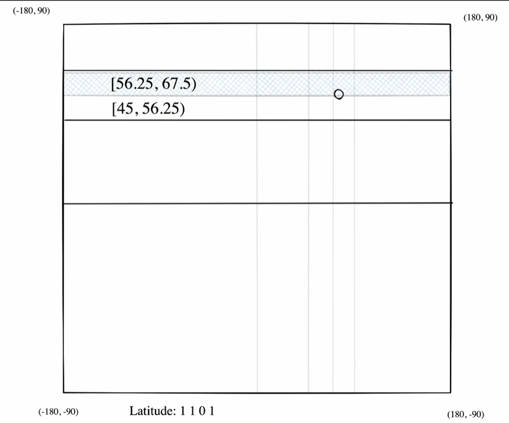
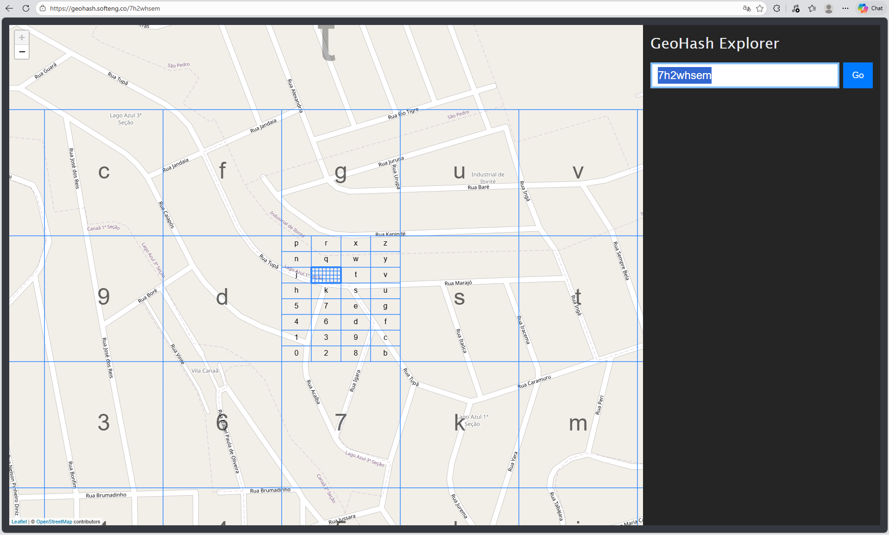
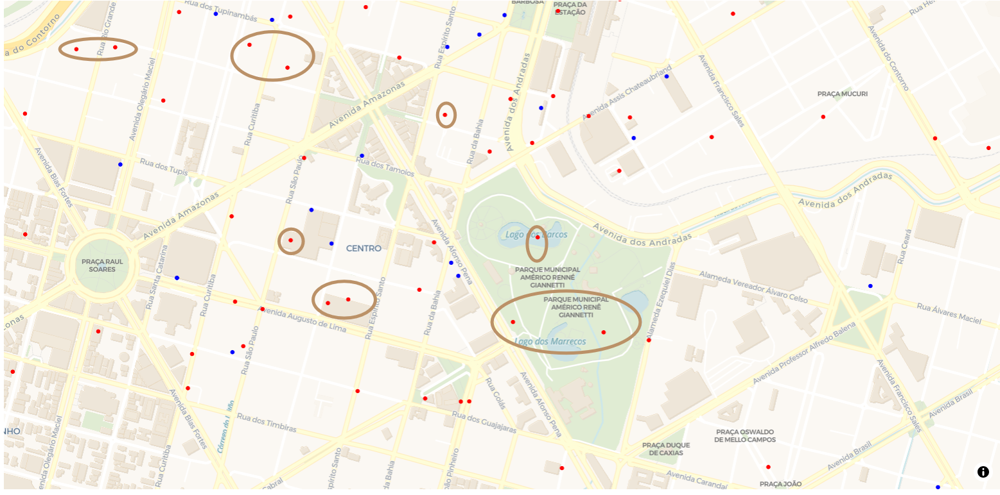
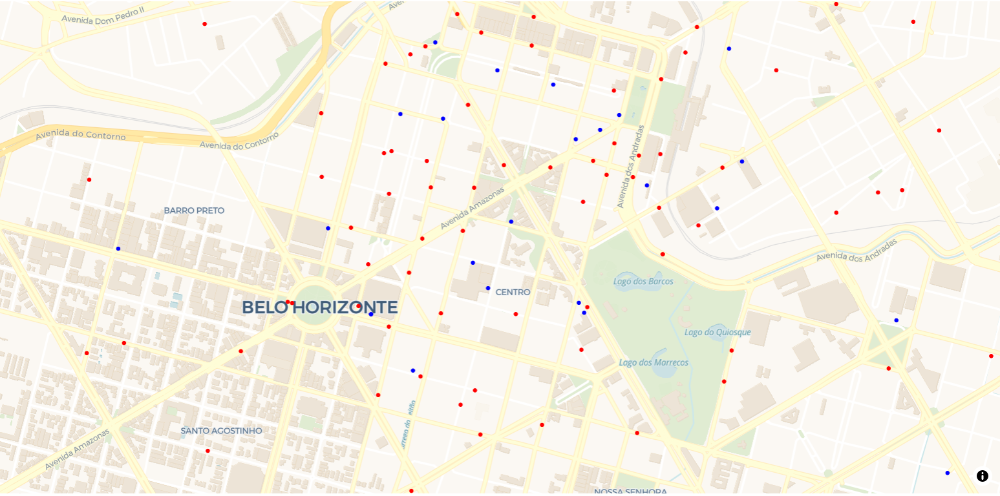
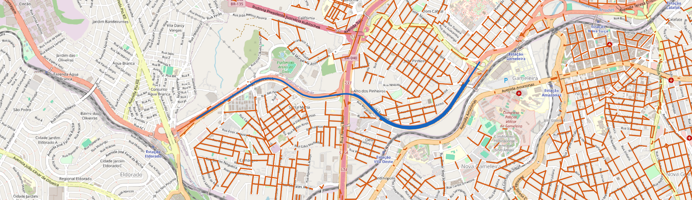

# Tropafood

TP1 ALG II

## Funcionalidades

- Exibe os bares cadastrados em `data/bares.csv`.
- Permite informar o numero N de entregadores que serao gerados
- Distribui os N entregadores equitativamente entre os bares com base numa distribuição normal centrada em cada bar. O resto da divisão é distribuído entre alguns bares aleatoriamente.
- Para nao gerar todos os entregadores no mesmo ponto, gera posições ao redor dos bares usando uma distribuição normal com desvio padrão de 400 metros.
- Ajusta cada posição para algum ponto da aresta (rua) mais proxima usando a malha viária do OpenStreetMap, via OSMnx.
- Permite salvar os resultados em CSV pela opção **Salvar CSVs desta geração**.
- Organiza os entregadores em uma Frota integrada à Trie compacta.
- Calcula a distância pelas ruas até o restaurante selecionado.
- Estima o tempo utilizando a velocidade de cada trecho do percurso.
- Apresenta os resultados em uma tabela ordenada pela distância viária.

## Requisitos

- Docker Desktop instalado e em execução.
- Acesso à internet na primeira geração, caso a malha viária ainda não esteja armazenada localmente.

## Executar a interface

Na pasta raiz do projeto, construa a imagem:

```powershell
docker build -t tropafood-app -f dockerfile .
```

Inicie o app com os arquivos locais montados no container:

```powershell
docker run --rm -p 8050:8050 -v "${PWD}:/app" tropafood-app
```

Abra [http://localhost:8050](http://localhost:8050) no navegador. O volume `-v` permite que o container use os arquivos do projeto no computador.

Na página, informe uma quantidade inteira positiva e clique em **Gerar entregadores**. A cada geração, o conjunto exibido é substituído pelo novo conjunto.

### Salvar os resultados

Marque **Salvar CSVs desta geração** antes de gerar. O app grava dois arquivos na pasta `data/`:

- `entregadores_matematicos_<identificador>.csv`: posições obtidas pela distribuição normal, antes do ajuste para as ruas.
- `entregadores_corrigidos_<identificador>.csv`: posições após o ajuste para a malha viária.

O identificador conta com data, hora (configurados no conteiner) e um código único. Assim, cada geração cria novos arquivos e não sobrescreve os CSVs anteriores. Se a opção estiver desmarcada, os CSVs não serão salvos.

## Executar o simulador pelo terminal

O simulador pode ser executado sem iniciar a interface:

```powershell
docker run --rm -it -v "${PWD}:/app" tropafood-app python -m src.simulador
```

O programa solicita a quantidade de entregadores. Se a resposta ficar vazia, usa 500. O arquivo de bares e o desvio padrão são definidos em `utilities/constants.py`.

No modo terminal, os arquivos são gravados nos caminhos fixos `data/entregadores_matematicos.csv` e `data/entregadores_corrigidos.csv`; execuçõe posteriores sobrescrevem os arquivos existentes.

## Malha viária

O módulo `src/grafo.py` obtém a malha viária de Belo Horizonte com o OSMnx, utilizando o tipo de rede `drive`. Essa escolha permite trabalhar com uma rede destinada à circulação de veículos e aproveitar as funções da biblioteca para obtenção, simplificação e cálculo dos percursos.

O grafo é dirigido para representar os sentidos disponíveis e é reprojetado para `EPSG:31983`, permitindo trabalhar com posições em metros. As arestas são identificadas por `(u, v, key)`: a chave distingue possíveis arestas paralelas entre os mesmos nós, e o atributo `length` representa o comprimento utilizado nas rotas.

A malha é salva em `data/malha_bh_drive_31983.graphml` e reutilizada nas execuções seguintes. O armazenamento local evita repetir o download e o processamento inicial, além de permitir utilizar a mesma malha durante os testes.

## Geocodificador

O script `scripts/geocodificador.py` busca coordenadas para os endereços de `data/bares.csv` e grava o resultado em `data/bares_com_coordenadas.csv`. Ele consulta o OpenStreetMap endereço por endereço e inclui uma pausa entre as consultas, pode levar horas para terminar

## Configurações

`utilities/constants.py` centraliza os caminhos, o desvio padrão e os sistemas de coordenadas usados pelo app e pelo simulador. O arquivo de entrada padrão é `data/bares.csv`, e o desvio padrão é 400 metros.

## Estrutura do projeto

```text
tropafood/
├── app.py                       # Interface interativa em Dash
├── assets/style.css             # Estilos da interface
├── data/                        # Bases, resultados e cache local do grafo
├── docs/tp1.pdf                 # Enunciado do trabalho
├── entities/                    # Entidades de restaurantes e entregadores
├── scripts/geocodificador.py    # Geocodificação de endereços
├── src/
│   ├── grafo.py                 # Carregamento ou geração da malha viária
│   ├── simulador.py             # Geração e ajuste das posições
│   ├── geohash.py               # Estrutura de geohash
│   └── trie.py                  # Estrutura Trie
│   ├── frota.py                 # Organização dos entregadores e resultados
│   ├── rotas.py                 # Cálculo de distância e tempo pelas ruas
├── utilities/
│   ├── constants.py             # Configurações compartilhadas
│   ├── files.py                 # Leitura de dados
│   └── interface.py             # Preparação do mapa
├── dockerfile                
├── main.py                    
└── requirements.txt
```

# Documentação Detalhada

## 1. Introdução

## 2. Indexação Geohash

*Geohashing* é um método de indexação capaz de converter coordenadas geográficas, como latitude e longitude, para uma string. A ideia é justamente converter duas dimensões (x, y) para uma única dimensão z. Essa string é definida na base 32 (`todos os números de 0-9 e letras do alfabeto - (a, l, i, o`), consistindo de 8 níveis na nossa implementação.

O algoritmo funciona da seguinte forma: Definimos limites superiores e inferiores para a latitude e longitude da terra, respectivamente $[-90, 90]$ e $[-180, 180]$, e então começamos a definir uma cadeia binária $Z$, que será constituida intercalando bits de longitude e latitude a cada iteração. Ao final, como queremos 8 caracteres na base 32, temos que ter um total de 40 bits, ou seja, vamos realizar 20 intercalações, nas quais cada uma adiciona 2 bits (longitude e latitude).

A intercalação funciona da seguinte forma (tanto para a longtitude quanto para a latitude, comparados com os seus respectivos limites):

1. Calculamos a coordenada média (ex: `long_mid = (long_upper + long_lower)/2`)
2. Checamos se a coordenada é maior ou menor que a coordenada média:
   1. se for maior ou igual, então devemos subir o limite inferior da coordenada e adicionar 1 na cadeia binária $Z$.
   2. se for menor, então devemos reduzir o limite superior da coordenada e adicionar 0 na cadeia binária $Z$.

A ideia é ter uma cadeia que represente a seguinte malha:



Ao final da intercalação, teremos uma cadeia de 40 bits intercados (20 de longitude e 20 de latitude). Agora, precisamos converter essa string binária para a base 32 e obter o geohash. Podemos fazer isso transformando cada 5 bits de $Z$ em um caractere base32.

Ao final, teremos uma indexação de 8 caracteres, como por exemplo: "7h2whsem". Essa string é referente à seguinte região em um mapa:


## 3. Árvore Trie Compacta

A árvore Trie Compacta, é uma estrutura de dados vista nas aulas que é, em essência uma árvore de prefixos. A ideia é armazenar strings de uma forma que seja fácil encontrar strings com prefixos iguais. Em nosso código, os seus nós são representados pela classe *TrieNode* que é composta por 3 atributos:

- *rotulo:* é a string armazenada naquele nó; (maior diferença em relação a Trie normal, aqui nós guardamos strings, e não somente o caractere)
- *filhos:* é um dicionário contendo os nós-filho daquele nó;
- *entregadores:* é uma lista dos entregadores que estão vinculados àquele rótulo terminal. Note que um entregador só constará na lista se o seu geohash terminar a sua inserção na Trie naquele nó. Esse atributo pode ser utilizado para saber se aquele nó é um nó com valor (possui entregador) ou não, basta verificar se a lista está vazia ou não.

Além disso, nós implementamos dois métodos para a classe *TrieCompacta:* 

*1. insert(entregador): $O(m)$, tal que m é o tamanho da string.* É responsável por inserir o geohash do entregador passado como parâmetro, vamos chamar de $g$ na árvore. Percorremos a árvore toda, partindo da raiz e consumindo a string $g$ com o passar dos nós. A ideia é, estando no nó atual, sempre buscar se existe algum filho com o caractere inicial que bate com o caractere na posição [0] do fragmento da cadeia $g$ que ainda não foi consumido.

Se não existir, então cria-se um nó filho na Trie com todo o rótulo restante.

Se existir, então  caminhamos até o filho e avaliamos como ele consegue consumir completamente o fragmento de $g$. Nós usamos uma função capaz de encontrar o maior prefixo entre duas strings. $O(min(s_1, s_2))$.

- Se o fragmento completamente consumido e o seu tamanho for igual ao do rótulo no nó, isso quer dizer que esse nó possui valor e deve adicionar o entregador que possui aquele geohash $g$ na lista de entregadores.
- Se o fragmento foi parcialmente consumido, então deve-se o nó da seguinte forma: definir dois filhos e um pai. O pai conterá como rótulo o prefixo em comum entre o fragmento de $g$ e o rótulo do nó antigo. O restante do rótulo do nó antigo e o restante não consumido de $g$ devem ser nós-filho.

2. *search(geohash): $O(m + k)$, tal que m é o tamanho da string.* Na busca, queremos buscar quais os entregadores referentes a um determinado geohash. Note que aqui existe uma sacada: Um geohash que é completamente consumido em um vértice pai deve considerar todos os entregadores dos filhos também, pois estes estão contidos no geohash pai. A busca funciona de forma parecida com a inserção, nós vamos percorremos a string $g$. até que seja completamente consumida dentro da árvore. Se não conseguimos, então retornamos uma lista vazia e a busca falha. Se conseguimos, temos que buscar todos os entregadores daquele nó, considerando também os filhos dele. Fazemos isso utilizando recursividade, parecido com uma DFS $O(k)$, tal que temos $k$ entregadores encontrados, que agrega os entregadores de cada nó.

## 4. Simulador de Geração de Entregadores

A modulo `src/simulador.py` contém a geração e a correção das posições dos entregadores, distribuindo os entregadores equitativamente entre os restaurantes por meio de uma distrbuição normal centrada em cada um dos restaurantes.

### 4.1 Distribuição Espacial Baseada em Demanda

A função `gerar_entregadores_normais` é responsável pela geração da posição inicial dos entregadores. Dado N sendo o Número de Entregadores a serem gerados e M o número de restaurante, a geração é feita da seguinte forma:

- lê a geometria de cada bar e usa suas coordenadas $x$, $y$, projetadas em metros como centro da distribuição normal.
- A quantidade solicitada é dividida entre os bares: todos recebem a mesma inteira quantidade $E$, obtida através de \(\lfloor N/M \rfloor\), e o resto R, caso a divisão não seja inteira, é distribuído aleatoriamente entre alguns bares.
- Para cada posição, são geradas coordenadas $x$ e $y$ com o desvio padrão configurado, que por padrão é 400 metros, a fim de não serem gerados varios entregadores no mesmo ponto.

Cada entregador recebe um id, o nome do bar de origem, as coordenadas matemáticas em metros ('EPSG:31983') e sua conversão para latitude e longitude ('EPSG:4326').

Como o exemplo a seguir mostra, essa geração ainda não é a ideal, uma vez que nem todos os pontos gerados respeitam a malha viária, como no exemplo a seguir, os pontos circulados foram plotados fora das ruas da malha, inclusive dentro do Parque Municipal Américo Renné.

**Pontos em Vermelho: Entregadores**
**Pontos em Azul: Restaurantes**



A geração utiliza coordenadas projetadas em `EPSG:31983`, cuja unidade é o metro. Essa escolha permite configurar o desvio padrão diretamente como uma distância, tornando mais claro o significado dos 400 metros utilizados na distribuição.

Latitude e longitude são mantidas em `EPSG:4326`, em graus, para a exibição no mapa e a codificação Geohash. Dessa forma, cada representação atende a uma finalidade: coordenadas métricas para geração e operações sobre as ruas, e coordenadas geográficas para apresentação e indexação.

A geometria e a latitude/longitude permanecem na mesma tabela para preservar a associação com os dados do restaurante. O formato `POINT`, por si só, não determina a unidade da geometria; essa unidade depende do sistema de coordenadas adotado.

### 4.2 Restrição Viária (Realismo Geográfico)

Como mencionado, a geração acima é feita com base em uma distribuição normal matemática, fatalmente haverá entregadores com coordenadas irreais, e.g. no meio da Lagoa da Pampulha, em cima de telhados, etc. Por isso, foi criada a função `corrigir_para_ruas`, que aloca os entregadores para posições válidas dentro de ruas reais.

A função `corrigir_para_ruas` recebe a tabela com os entregadores e suas posições matemáticas e, para cada entregador, consulta a aresta da malha viária de BH mais próxima de cada posição matemática com o OSMnx. Em seguida, projeta o ponto com coordenadas $x$ e $y$ em metros na rua usando o Shapely e transforma as coordenadas resultantes para latitude e longitude. Dessa forma, a posição corrigida pode ser exibida sobre a malha viária.

Para encaixar os entregadores sobre a linha real das ruas, a função chama `nearest_edges` do osmnx, que identifica o trecho de rua mais próximo de cada ponto matemático. A partir daí, é extraída a geometria da rua. Utilizando o Shapely, o ponto é projetado sobre essa linha: o método `project` descobre a posição exata ao longo do trecho e o `interpolate` pega as novas coordenadas. Como toda essa operação ocorre em metros `EPSG:31983`, as distâncias e projeções são tratadas em metros. Por fim, as coordenadas corrigidas são convertidas para graus (latitude e longitude `EPSG:4326`) para a renderização no mapa da interface.

Além das coordenadas corrigidas, são armazenados os campos `aresta_u`, `aresta_v`, `aresta_key` e `posicao_aresta_metros`. Eles identificam a aresta associada ao entregador e sua posição ao longo da geometria orientada de u para v.

Preservar essas informações permite reutilizar a associação com a rua nas consultas posteriores e representar o entregador no meio de um trecho, sem restringir sua posição aos cruzamentos.

A seguir, temos um exemplo da geração com a correção aplicada, onde todos os entregadores são plotados dentro das ruas.

**Pontos em Vermelho: Entregadores**
**Pontos em Azul: Restaurantes**



O simulador, além de utilizado na interface, pode ser executado pelo terminal. Nesse modo, ele solicita a quantidade de entregadores e grava os CSVs matemáticos e corrigidos nos caminhos padrão definidos em `utilities/constants.py`.

Em `utilities/files.py`, a geometria dos restaurantes é interpretada para preencher suas coordenadas x e y. Os entregadores são criados com as coordenadas corrigidas e os metadados da aresta, preservando essas informações desde a leitura dos dados até o cálculo das rotas.

### 4.3 Benchmark Simulador

O benchmark (`scripts/benchmark_frota.py`) mede separadamente a geração e a correção para ruas com 1.000, 10.000, 100.000 e 1.000.000 de entregadores. Usa os bares de `data/bares.csv` e executa cada tamanho cinco vezes. Os testes foram executados em uma máquina com i7 13th, 32ram, 512ssd e windows 11:

#### 4.3.1 Análise assintótica

**Geração dos Entregadores:**

Para M restaurantes e N entregadores, a geração percorre os restaurantes e cria N registros, resultando em tempo O(M + N) e memória O(M + N). Com a base fixa, seu custo é O(N).

**Correção para a Malha Viária:**

Na correção, cada entregador é consultado na malha e projetado na rua mais próxima. Para uma malha fixa, podemos afirmar um possível crescimento linear O(N).

#### 4.3.2 Análise empírica

A leitura do CSV de bares e o carregamento da malha são feitos antes da medição. A geração inclui a conversão das coordenadas de metros para graus e a correção inclui a busca da aresta mais próxima, a projeção na rua e a conversão das coordenadas.
As médias são gravadas em `data/benchmark_frota.csv`.

Segue abaixo os tempos obtidos ao executar o benchmark na máquina citada anteriormente:

| Entregadores | Geração | Correção para ruas |
| ---: | ---: | ---: |
| 1.000 | 0,729 | 0,923 |
| 10.000 | 0,766 | 1,545 |
| 100.000 | 1,176 | 8,103 |
| 1.000.000 | 5,394 | 72,169 |

Ao aumentar a frota de 1.000 para 1.000.000 de entregadores (1.000 vezes), o
tempo medido aumentou cerca de 7,4 vezes na geração e 78 vezes na correção.
O crescimento observado foi sublinear nessa faixa de teste, mas isso não
determina a complexidade assintótica: custos fixos e características do ambiente
influenciam os tempos medidos.

## 5. Interface do mapa

O mapa da aplicação é construído com Dash e Plotly, utilizando traços `Scattermap` para exibir os pontos sobre a cartografia de fundo. Os entregadores são representados por marcadores circulares posicionados nas coordenadas corrigidas para as ruas; ao passar o cursor sobre um marcador, é exibido o ID do entregador.

É possível buscar um restaurante pelo nome e definir um raio de busca em metros. O valor deve estar entre 100 e 50.000 metros; caso contrário, a interface informa que o raio é inválido. Ao selecionar um restaurante, o mapa o destaca com um marcador e centraliza a visualização nele. Os entregadores dentro do raio ficam verdes, enquanto os que estão fora permanecem vermelhos. O resumo informa quantos entregadores estão dentro do raio em relação ao total exibido. A opção **Exibir raio de busca** desenha a área circular configurada no mapa.

A opção **Exibir todos os restaurantes** adiciona ao mapa os demais restaurantes. Sem um restaurante selecionado, os entregadores aparecem em vermelho. Na abertura da aplicação, os entregadores ainda não são exibidos; eles aparecem após a geração de uma frota.

## 6. Aplicação web

O arquivo `app.py` monta a aplicação Dash. Na abertura, carrega os bares e apresenta o mapa inicial, a princípio sem os entregadores. A página possui um campo para inserir a quantidade de entregadores a serem gerados, um botão para a geração e uma opção para salvar os resultados em CSV.

Ao clicar no botão, o callback valida a quantidade de entregadores, onde é necessário que o valor inserido seja inteiro maior que zero, gera uma nova frota, carrega a malha, corrige as posições para as ruas e atualiza o mapa. A frota de entregadores que foi gerada a esse ponto substitui a que estava sendo exibida anteriormente.

A página também possui um checkbox **Salvar CSVs desta geração**, quando este esta marcado, o app grava dois arquivos: um com as posições matemáticas e outro com as posições corrigidas. Os nomes recebem um identificador de data e hora e um código aleatorio, a fim de evitar a sobrescrição dos arquivos gerados anteriormente.

Além disso, também conta com um campo para selecionar algum bar em específico e traçar a busca por entregadores em um determinado raio de distância, que também pode ser configurado.

Os registros da geração são mantidos em um `dcc.Store` em memória no navegador. Isso permite trocar o restaurante e comparar os percursos dos mesmos entregadores, sem gerar novas posições. Uma nova geração substitui os registros anteriores, e recarregar a página limpa esse armazenamento.

Os callbacks separam a geração, a atualização do mapa e a consulta das rotas. Essa organização evita que uma mudança de restaurante execute novamente a geração dos entregadores.

O botão **Mostrar tabela** abre os resultados em um painel separado, com mais espaço para leitura das colunas. O botão **Fechar** recolhe esse painel. Essa organização mantém os controles da simulação no painel lateral e permite consultar a tabela sobre o mapa.

A função `montar_tabela_rotas()`, em `utilities/interface.py`, mantém a ordenação fornecida pela Frota. A distância é apresentada em metros, e o tempo, calculado em segundos, é arredondado para o segundo mais próximo e exibido em minutos e segundos, como `2 min 30 s`. Resultados sem caminho aparecem como **Sem rota**, diferenciando essa situação de um percurso com distância zero.

## 7. Entregadores, restaurantes e organização da Frota

As classes `Entregador` e `Restaurante`, na pasta `entities/`, representam os participantes da simulação. Elas reúnem os dados de cada participante, enquanto a geração das posições, a busca e o cálculo dos percursos ficam nos módulos responsáveis por essas operações.

O `Entregador` possui um identificador, coordenadas geográficas, coordenadas métricas, Geohash e informações sobre sua posição na aresta. O identificador permite associar cada resultado ao entregador correto, mesmo depois da ordenação da tabela. A posição utilizada é a corrigida para as ruas, conforme explicado na seção de restrição viária.

O `Restaurante` possui identificador, nome, endereço e coordenadas. Sua localização serve como centro da distribuição dos entregadores e como referência para as consultas. No cálculo das rotas, suas coordenadas métricas são usadas para localizar o destino na malha viária. Um entregador pode ser consultado em relação a qualquer restaurante, independentemente daquele utilizado na geração de sua posição.

As funções de `utilities/files.py` fazem a conversão dos registros em objetos dessas classes. `ler_bares()` interpreta a geometria do CSV para criar os restaurantes, enquanto `ler_entregadores()` e `criar_entregadores()` criam entregadores a partir do CSV ou dos registros da geração. Na interface, os restaurantes são consultados diretamente na tabela carregada com pandas, e os objetos `Entregador` são criados para trabalhar com a Frota.

A classe `Frota`, em `src/frota.py`, reúne os objetos `Entregador` e sua integração com a Trie compacta. Na construção da Frota, os Geohashes são calculados a partir das coordenadas corrigidas, e os entregadores são inseridos no índice.

O método `_localizar_entregador()` prepara a posição de cada entregador na malha, aproveitando a identificação da aresta armazenada. Quando todos os identificadores estão ausentes, procura a rua mais próxima; quando estão parcialmente preenchidos, informa o problema.

O método `calcular_rotas()` recebe o grafo, as coordenadas métricas do restaurante e uma lista de entregadores selecionados. Ele solicita os percursos ao módulo de rotas, associa os resultados aos IDs e depois ordena pela distância.

Essa divisão permite que a seleção espacial forneça os candidatos, que o módulo de rotas calcule os percursos e que a Frota organize os resultados para a interface. A associação aos IDs acontece antes da ordenação para preservar a correspondência entre cada entregador e suas medidas.

Os resultados são retornados em novos registros, sem modificar os objetos originais. Quando não existe caminho, distância e tempo recebem `None`, e o entregador fica ao final da lista.

## 8. Cálculo das rotas e do tempo

O módulo `src/rotas.py` calcula os percursos utilizando a malha viária. A distância pelas ruas foi escolhida porque a proximidade geográfica não representa necessariamente o deslocamento disponível: um entregador pode precisar contornar um quarteirão ou seguir outro sentido de circulação.

A função `obter_geometria_aresta()` recupera o traçado de uma aresta existente e o orienta de u para v. Quando não há geometria explícita, utiliza um segmento entre esses nós. Esse procedimento representa uma conexão já existente no grafo, sem criar uma rua nova. As curvas dos trechos unidos pela simplificação do OSMnx são preservadas na geometria resultante.



Conferência da malha viária no QGIS sobre o mapa do OpenStreetMap. Em azul, uma amostra de arestas com curvas preservadas; em laranja, segmentos entre os nós de arestas sem geometria explícita. A inspeção permite comparar os traçados do grafo com as vias representadas no mapa.

Base cartográfica: © [OpenStreetMap contributors](https://www.openstreetmap.org/copyright).

A função `calcular_rotas_osmnx()` utiliza a busca de menor caminho do OSMnx com o peso `length`. Como entregadores e restaurantes podem estar no meio das ruas, são adicionados nós e conexões em uma cópia temporária do grafo. Isso permite considerar os trechos parciais de saída e chegada e preservar a malha original. Também é tratado o caso em que origem e destino estão na mesma aresta.

Para estimar o tempo, a função `preparar_tempos()`, em `src/grafo.py`, acrescenta os atributos `speed_kph`, em km/h, e `travel_time`, em segundos. A preparação utiliza as velocidades informadas no OSM e estima os valores ausentes com base nas velocidades disponíveis e na categoria da via.

O tempo dos trechos parciais é calculado utilizando a velocidade da aresta correspondente. Ao percorrer a rota, distância e tempo são somados sobre as mesmas arestas, inclusive quando existem arestas paralelas. Isso evita combinar a distância de uma via com o tempo de outra.

O critério da busca continua sendo a menor distância. O tempo apresentado corresponde a esse mesmo percurso, sem uma busca separada pela rota mais rápida. A estimativa não considera trânsito, semáforos, paradas ou preparação do pedido.

As verificações realizadas incluíram trechos parciais, sentidos disponíveis, pontos nos extremos, arestas paralelas e ausência de caminho. Também foram conferidas a associação dos resultados aos IDs, a ordenação e a atualização das consultas sem regenerar as posições dos entregadores.

## INTEGRANTES

- Marney Santos de Melo — 2024106034
- Rafael Resende Miranda — 2024065990
- Victor Murilo Kaizer — 2024096551
